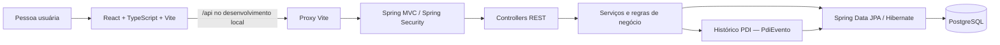
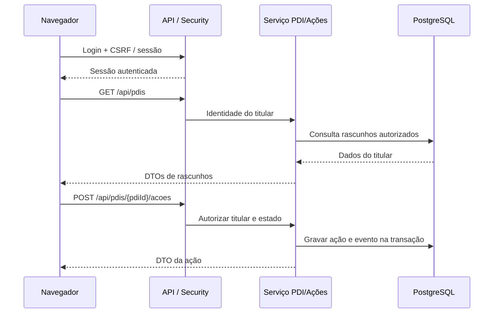

# TalentSynk — Arquitetura do sistema

> **Referência documental:** arquitetura identificada nos commits de código auditados. Base técnica: [front-end `01cd6d3`](https://github.com/nisyDev/idp-frontend/tree/01cd6d322c1efb4b843756f13471c196851ecf42) e [back-end `38573f9`](https://github.com/nisyDev/idp/tree/38573f9ab19b9181a3adf516533bbd8849b80def), conforme auditoria G5A e [PROJECT_STATE.md](PROJECT_STATE.md). Este documento descreve a **arquitetura atual**, não uma certificação de produção.

## 1. Visão e escopo

O TalentSynk busca tornar o Plano de Desenvolvimento Individual (PDI) um processo contínuo de evolução. O domínio de negócio está descrito em [BUSINESS.md](BUSINESS.md). A implementação atual concentra-se em autenticação local, rascunhos privados de PDI, cadastro/consulta de ações, consulta de cargos e edição de ações no back-end.

O sistema ainda não possui deploy público, operação beta nem implementação integral dos módulos previstos na visão de negócio.

## 2. Componentes e fluxo atual

- **Interface:** React, TypeScript e Vite. A autenticação e os formulários de rascunho utilizam chamadas reais à API; dashboard, organograma, capacitação, sugestões e partes de perfil/reuniões continuam demonstrativos ou parciais.
- **Transporte no desenvolvimento:** requisições relativas a `/api`, com proxy Vite para `127.0.0.1:8081`. O proxy **não** é uma arquitetura de publicação definida para produção.
- **Camada HTTP:** controllers REST sob configuração Spring Security; DTOs limitam campos expostos e aceitos.
- **Aplicação e domínio:** serviços de autenticação, identidade, PDI, ações e catálogo de cargos coordenam autorização, regras e transações.
- **Persistência:** PostgreSQL, Spring Data JPA/Hibernate; migrations versionadas por Flyway V1–V3. A habilitação automática do Flyway fica desativada em `auth-local`.

[Dependências do back-end](https://github.com/nisyDev/idp/blob/38573f9ab19b9181a3adf516533bbd8849b80def/pom.xml) · [Dependências do front-end](https://github.com/nisyDev/idp-frontend/blob/01cd6d322c1efb4b843756f13471c196851ecf42/package.json) · [Proxy Vite](https://github.com/nisyDev/idp-frontend/blob/01cd6d322c1efb4b843756f13471c196851ecf42/vite.config.ts)

## 3. Autenticação e autorização

| Recorte | Comportamento conhecido | Limitação |
|---|---|---|
| `auth-local` | Login por e-mail/senha com BCrypt; sessão HTTP, cookie HttpOnly/SameSite=Lax, CSRF, `/api/auth/me` e logout | Configurado para loopback; não constitui implantação segura de produção |
| `demo-local` | HTTP Basic demonstrativo, usuário ativo e CSRF conforme configuração | Não é o mecanismo de autenticação corporativa |
| Sem esses perfis | Cadeia HTTP de bloqueio | Não se trata de modo operacional da aplicação |
| Papéis internos | `COLABORADOR`, `GESTOR`, `RH_ADMIN` definidos pelo servidor | Authorities não implementam automaticamente toda a matriz de permissões |

Rascunhos nunca submetidos e ações correspondentes são privados do titular, **inclusive** quando ele possui papel de gestor ou RH. Não há acesso genérico à equipe nem acesso irrestrito do RH. As decisões de privacidade da Etapa 21B permanecem válidas como requisitos para os próximos incrementos.

A opção de lembrar acesso persiste o cookie da **mesma** sessão, mas não renova automaticamente o timeout no servidor. O SSO Microsoft Entra ID está **planejado**, não implementado.

## 4. Ciclo de rascunho PDI — fluxo disponível

A edição do rascunho de PDI está integrada ao front-end. A **edição de ações** por PUT já existe no back-end, grava `ACAO_EDITADA` e tem cobertura isolada, mas a tela de edição e sua validação PostgreSQL específica continuam pendentes. Não há fluxo operacional completo de submissão, aprovação, rejeição, execução ou conclusão.

## 5. Persistência, consistência e auditoria

- **CORE:** quatro tabelas iniciais, identificadores UUID; identidade de usuário, cargo, equipe e histórico de equipe.
- **PDI:** oito tabelas na V2, identidades `BIGINT`/`Long` e separação entre PDI, versões, ações, componentes, entregas e eventos.
- **Credenciais locais:** uma tabela adicional na V3, associação opcional 1:1 com usuário, por UUID compartilhado (`@MapsId`).
- **Histórico implementado:** `CRIACAO`, `EDICAO_RASCUNHO`, `ACAO_ADICIONADA` e `ACAO_EDITADA`; os eventos utilizam JSONB e a mesma transação dos fluxos que os geram.
- **Concorrência e propriedade:** `PDI.lock_version` utiliza `@Version`; cadastro/edição de ações coordenam bloqueios `Usuario → PDI → PdiVersao`. Isso não certifica todos os cenários concorrentes nem substitui testes físicos.

Consulte [DATABASE.md](DATABASE.md) para o inventário físico e a distinção em relação ao catálogo lógico.

## 6. Qualidade e ambientes

| Evidência | Estado e limite |
|---|---|
| Build do front-end | `tsc -b && vite build` aprovado na referência G3 |
| Compilação do back-end | `BUILD SUCCESS` na G4C.1, 74 arquivos de produção e 25 de teste |
| Testes isolados de back-end | 267 aprovados em 20 classes na G4C.2; sem PostgreSQL ou Flyway |
| Testes de edição de ações | 82 dentro dos 267 (46 de serviço e 36 HTTP); sem comprovação física de rollback |
| Persistência PostgreSQL | Execuções históricas aprovadas nos recortes de PDI e credenciais locais; **cinco novos cenários** de edição ainda pendentes |
| Produção | Nenhuma publicação operacional ou beta validado |

Os testes de persistência controlada exigem autorização e verificação do destino antes de qualquer escrita. Este documento não contém comandos de inicialização, segredos ou instruções de migrations.

## 7. Evolução prevista, não implementada

- Fluxo completo de aprovação, revisão, execução e conclusão do PDI.
- Integrações Microsoft Entra ID (identidade) e Teams (reuniões), em incrementos próprios.
- Módulos funcionais de OKRs, feedbacks, competências, capacitações, avaliações, notícias e indicadores.
- Matriz RBAC completa, revisão de dados demonstrativos, segurança de produção e estratégia de deploy/beta.

Decisões e prioridades: [DECISIONS.md](DECISIONS.md) e [ROADMAP.md](ROADMAP.md). Os contratos disponíveis: [API.md](API.md).
