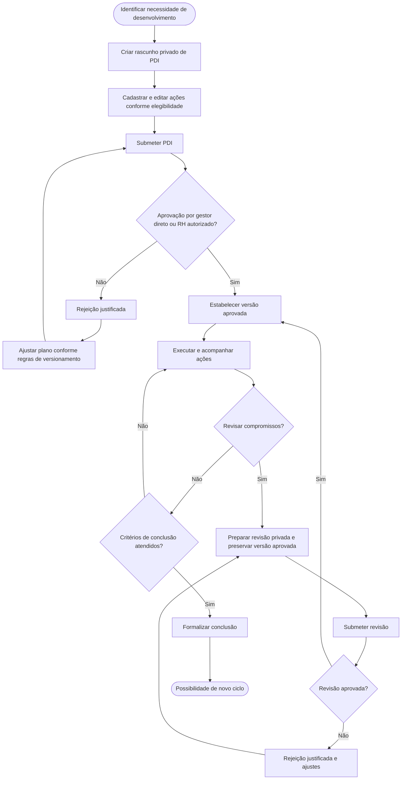

# TalentSynk — Jornada de Desenvolvimento Individual

**Estado:** proposta TO-BE — pendente de validação organizacional  
**Data:** 24/11/2026  
**Escopo:** módulo PDI (Plano de Desenvolvimento Individual)

## 1. Objetivo

Representar o ciclo funcional do PDI, desde a identificação de necessidades de desenvolvimento até a conclusão formal do plano. A jornada descreve o processo pretendido, não a metodologia atualmente praticada pela empresa nem uma garantia de disponibilidade de todas as funcionalidades.

## 2. Participantes e responsabilidades

| Perfil | Responsabilidade |
|---|---|
| Colaborador | Elaborar o plano, cadastrar ações, submeter para validação, executar e acompanhar o desenvolvimento. |
| Gestor direto | Avaliar o plano submetido, aprovar ou justificar a rejeição e acompanhar o desenvolvimento conforme suas permissões. |
| RH autorizado | Participar da validação e do acompanhamento conforme as regras de autorização. |

A responsabilidade pela conclusão formal e os limites operacionais do acompanhamento ainda precisam ser detalhados.

## 3. Jornada funcional

### 3.1. Diagnóstico
Identificar necessidades de desenvolvimento e objetivos profissionais. A origem do diagnóstico (feedback, avaliação, reunião 1:1 ou iniciativa própria) ainda deve ser validada. Esta etapa é conceitual e não pressupõe uma funcionalidade automatizada.

### 3.2. Planejamento
O titular cria um rascunho privado de PDI e define título, objetivo e período planejado. Cadastra ações com título, objetivo, resultado esperado e datas planejadas. No primeiro rascunho, esses campos podem ser preenchidos progressivamente, conforme as validações existentes. A edição inicial deve respeitar as condições de elegibilidade documentadas; não constitui uma autorização genérica para editar qualquer versão.

### 3.3. Submissão e validação
O titular submete o plano à avaliação. O gestor direto ou RH autorizado aprova ou rejeita justificadamente. Em caso de rejeição, o titular ajusta e reenvia o plano, respeitando as regras de versionamento. Os critérios mínimos para submissão devem ser conferidos nas especificações antes da implementação.

### 3.4. Execução e acompanhamento
Após aprovação, o colaborador executa as ações e acompanha seu desenvolvimento. A forma de registrar progresso, evidências e periodicidade de acompanhamento precisa ser definida. A versão aprovada constitui a referência dos compromissos assumidos.

### 3.5. Revisão dos compromissos
Quando for necessário alterar compromissos aprovados, uma revisão é preparada privadamente e submetida a nova aprovação. A versão aprovada anterior é preservada até a aprovação da revisão. Rejeições exigem justificativa e permitem ajustes e reenvio conforme as regras aplicáveis.

### 3.6. Conclusão
A conclusão do PDI é formal e não decorre automaticamente do percentual de progresso. Os critérios e o responsável pelo encerramento precisam ser validados. Após a conclusão, um novo ciclo pode ser considerado, sem pressupor criação automática.

## 4. Fluxograma funcional

A ramificação de revisão representa o trâmite de alteração dos compromissos, não uma suspensão automática da execução da versão aprovada.

## 5. Rastreabilidade e estado de implementação

| Etapa | Referência documental | Estado de referência |
|---|---|---|
| Diagnóstico | BUSINESS.md | Conceitual |
| Criação do rascunho | DECISIONS.md (DEC-04 e DEC-14); PROJECT_STATE.md | Implementado |
| Cadastro de ações | PROJECT_STATE.md | Implementado |
| Edição inicial de ações | DECISIONS.md (DEC-09 e DEC-14); PROJECT_STATE.md | Parcial |
| Submissão | ROADMAP.md | Planejado |
| Aprovação e rejeição | DECISIONS.md (DEC-11) | Planejado |
| Revisão | DECISIONS.md (DEC-12) | Planejado |
| Execução e acompanhamento | BUSINESS.md; ROADMAP.md | Planejado |
| Conclusão formal | DECISIONS.md (DEC-13) | Planejado |

Os estados e identificadores acima reproduzem a análise documental anterior; não constituem auditoria atual do código. Conferir os documentos de origem antes de utilizar esta tabela como evidência de implementação.

## 6. Questões pendentes de validação

- Qual evento inicia o PDI e qual metodologia orienta sua elaboração?
- Quais categorias de desenvolvimento devem existir?
- Quais critérios mínimos permitem a submissão?
- Como medir progresso e comprovar resultados?
- Qual a periodicidade de acompanhamento?
- Quem formaliza a conclusão e quais critérios deve observar?
- Como tratar cancelamento, interrupção ou mudanças organizacionais?

## 7. Referências

- [BUSINESS.md](https://github.com/nisyDev/idp-docs/blob/main/BUSINESS.md)
- [DECISIONS.md](https://github.com/nisyDev/idp-docs/blob/main/DECISIONS.md)
- [PROJECT_STATE.md](https://github.com/nisyDev/idp-docs/blob/main/PROJECT_STATE.md)
- [ROADMAP.md](https://github.com/nisyDev/idp-docs/blob/main/ROADMAP.md)

Este documento deve evoluir após a validação com colaboradores, gestores e RH. As necessidades dos usuários e os benefícios esperados ainda não constituem evidências empíricas.
